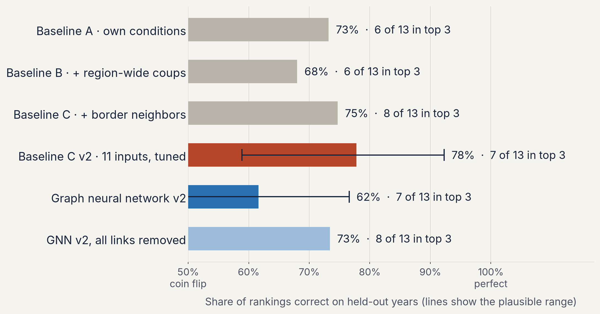
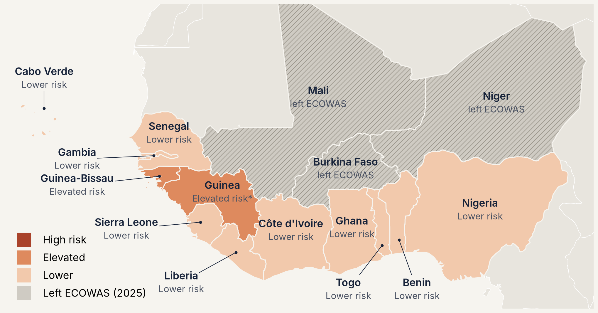

# Forecasting ECOWAS Sanctions Risk with Graph Neural Networks

[](https://github.com/landontownsend/ecowas-sanctions-gnn/actions/workflows/ci.yml)

When a West African government falls to a coup or stalls its return to civilian rule, the regional bloc ECOWAS often suspends it, sanctions it, or closes its borders, and those actions cut the country's imports well behind the rest of the region. This project asks whether conditions in a member state, measured the year before, can forecast that response, and whether modeling the region as a **network of linked states** improves the forecast.

It builds a country-year panel of all 15 ECOWAS members from 2001, when ECOWAS adopted its Protocol on Democracy and Good Governance, to 2024. The panel combines V-Dem, the World Bank, 833 million GDELT news events, and hand-coded ECOWAS actions in a DuckDB warehouse. The project then tests **graph neural networks (GraphSAGE and graph attention networks, PyTorch Geometric)** against penalized logistic regressions, under a design and decision rule that were committed to the repository before any result was run.



## Key results (version 2, 2001 to 2024)

24 held-out years, 360 country-years, 13 ECOWAS actions. The design is in [`docs/project-context.md`](docs/project-context.md), section 7, committed before the first run.

| Model | Held-out AUC | Action in its year's top 3 |
|---|---|---|
| Baseline A: own conditions (version 1 inputs) | 0.73 | 6 of 13 |
| Baseline B: + region-wide coups (version 1 inputs) | 0.68 | 6 of 13 |
| Baseline C: + border neighbors (version 1 inputs) | 0.75 | 8 of 13 |
| **Baseline C v2: 11 own-country inputs + border neighbors, tuned** | **0.78** | **7 of 13** |
| Graph neural network v2 (GraphSAGE or GAT, tuned) | 0.62 | 7 of 13 |
| Graph neural network v2, all links removed | 0.73 | 8 of 13 |

* **Baseline C v2 is the best model in the project.** Adding GDELT protest and violence shares, ECOWAS's own record, years since the last coup, failed coups, mass mobilization, and economic conditions raises held-out AUC from 0.75 to 0.78 on the same 24 years. Under the decision rule, it is the main model, and it produces the watch list and the risk map.
* **The graph neural network did not beat it.** GNN v2 scored 0.62. The year-clustered bootstrap interval for the difference (GNN v2 minus Baseline C v2) is [-0.35, 0.00], and the GNN is ahead in 2.6% of resamples. Both models put 7 of 13 actions in the top 3 of their year, so the GNN ranks countries within a year about as well. Its scores, however, change scale from one held-out year to the next (the highest score in a year ranges from 0.000 to 1.000), which is a sign of overfitting with 11 inputs and 13 actions, and the pooled AUC penalizes that.
* **With richer inputs, learned neighbor links hurt.** In version 1 (3 inputs), removing the border links lowered the GNN's AUC from 0.74 to 0.66. In version 2 (11 inputs), removing every link raised it from 0.62 to 0.73. The hand-built neighbor summaries in Baseline C v2 (highest military rule score among neighbors, their recent coups) carry the network signal better than learned message passing does at this sample size.
* **One case where the GNN did better.** Trained through 2024, GNN v2 ranked Guinea-Bissau 3rd of 15 for 2025, before its November 2025 coup and suspension. Baseline C v2 ranked it 12th. This is one case, not a general result.
* **Actions are costly.** In 11 of 13 actions, real imports fell behind members facing no action that year, by a median of about 10 percentage points (Niger 2023: 29 points). Coastal targets fell further than landlocked ones (median 15 vs. 4 points). The clear exception is Niger 2009, a suspension with no trade measures, during which Niger's imports grew 31 points faster than the region's.
* **Coups and actions go together.** 8 of 12 successful-coup years drew an ECOWAS action; none of the 8 years with only failed attempts did.

**Checks.** The full run gives identical results on GitHub Actions and on a second machine. Run with the version 1 setup, the version 2 code reproduces the version 1 results (GNN 0.74, 0.66 without links), so the change comes from the design, not the code.

## Version 1 results (2010 to 2024)

15 held-out years, 225 country-years, 10 actions; GNN node features: 3 own-country inputs.

| Model | Held-out AUC | Action in its year's top 3 |
|---|---|---|
| Baseline A: own conditions | 0.76 | 5 of 10 |
| Baseline B: + region-wide coups | 0.71 | 5 of 10 |
| Baseline C: + border neighbors | 0.78 | 6 of 10 |
| Graph neural network (GraphSAGE) | 0.74 | 5 of 10 |
| Graph neural network, border edges removed | 0.66 | 4 of 10 |

The version 1 code and outputs are in the git history at commit `d437885`.



## Approach

**Data.** One row per member per year, 2001 to 2024 (15 x 24 = 360). Political inputs come from V-Dem v16 (official release, `vdeminstitute/vdemdata`), including the Powell and Thyne coup counts, a military rule index, and mass mobilization. Economic inputs come from the World Bank World Development Indicators. News-event inputs come from GDELT 1.0: every event file from 2000 to 2025 (4,727 files, 833 million rows) was counted by country and month in GitHub Actions; the model uses each member's yearly share of protest events and of violent events. The 13 ECOWAS actions (suspensions, sanctions, border closures) are hand-coded from ECOWAS communiqués and news coverage.

**Network.** Members are nodes. Two kinds of links: shared land borders (Cabo Verde has none) and membership of the West African Economic and Monetary Union (the eight CFA franc countries). One graph per year.

**Outcome.** Whether ECOWAS took any new punitive action against a member that year. A 0 to 3 severity scale is kept for description.

**Inputs.** All from the year before: military rule index, successful coups, own coups over three years, failed coups, mass mobilization, GDP growth, inflation, an ECOWAS action the year before, years since the last coup (up to 20), GDELT protest share, GDELT violence share. Missing economic values are filled with the training median in each fold.

**Baselines (Stage 1).** L2-penalized logistic regressions (scikit-learn, balanced class weights, standardized inputs):
* A, B, C: the version 1 specifications (C = 1): own military rule and coups; + region-wide coups; + highest military rule score among bordering members and their coups over three years
* C v2: the 11 inputs plus the two border summaries, with the penalty tuned from {0.01, 0.1, 1, 10}

**Graph neural network v2 (Stage 2).** Two graph layers and a linear output, weighted binary cross-entropy, Adam (learning rate 0.01, weight decay 0.005), dropout 0.2, 300 epochs, averaged over a 25-seed ensemble. Node features are the 11 own-country inputs only, so the network must learn how to use its neighbors. Tuned over 8 settings: GraphSAGE or GAT, borders only or borders plus WAEMU links, hidden size 16 or 32. An ablation removes every link.

**Tuning and evaluation.** Leave one year out: train on 23 years, score the held-out year, repeat for all 24. Inside each fold, settings are chosen by 4-fold cross-validation over the training years only, so the held-out year is never used for tuning. The tuning chose GAT in 20 of 24 folds and the WAEMU links in 17. Metrics are pooled AUC and top-3 hits per year, with a year-clustered bootstrap (2,000 resamples) for the GNN v2 minus Baseline C v2 difference. The decision rule, fixed in advance: GNN v2 becomes the main model only if its AUC is higher. A separate check trains on 2001 to 2024 and scores 2025.

**Economic impact.** Change in real imports from the year before an action to the average of the action year and the year after, minus the median change among members with no action that year.

## Data pipeline

```
 World Bank API ─┐
 (or snapshot)   │      DuckDB warehouse (data/warehouse/ecowas.duckdb)
 V-Dem release ──┤
 GDELT snapshot ─┼──►  raw ──► staging ──► features ──► checks ──► data/processed/ ──► models
 ECOWAS events ──┤      (as      (clean,     (one row per    (stop on     (CSV for the
 config.yaml ────┘       loaded)  renamed)    member-year)    bad data)    model scripts)
```

* **Ingest** (`pipeline/ingest.py`): World Bank indicators come from the World Bank API in live mode, or from the saved snapshot by default, so results are reproducible. V-Dem has no live API, so the pipeline loads a versioned release subset (`scripts/make_vdem_subset.py`). GDELT is too large to download on every run, so a GitHub Actions workflow (`refresh-data.yml`) downloads and counts all event files in parallel and commits a monthly snapshot. Every load is recorded in `meta.load_log`.
* **Transform** (`sql/staging.sql`, `sql/features.sql`): SQL models in DuckDB build every model input once: the lagged inputs, the region-wide and border-neighbor features, years since the last coup, the GDELT shares, and the import damage measure. The output is two tables, the study-period panel and the inputs for the years after it (the 2025 check and the 2026 watch list). The model scripts only read these tables.
* **Checks** (`pipeline/checks.py`): 20 data quality checks, for example one row per member per year, a military rule index between 0 and 1, two-way borders, GDELT shares between 0 and 1, and complete forecast inputs. The run stops if any check fails.
* **Configuration** (`config.yaml`): years, members, the border network, GDELT codes, data sources, paths, feature lists, tuning grids, watch list tiers, and every model setting are in one file.
* **Tests and CI**: pytest covers API parsing, the SQL features, the checks, and the watch list rules. GitHub Actions runs the tests, the pipeline, and the baselines on every push, confirms that the outputs match the committed results, tests the live World Bank API, runs a one-minute GNN smoke test, and builds the Docker image. A second workflow (`run-models.yml`) runs the full project and commits the outputs.

## Repository structure

```
ecowas-sanctions-gnn/
├── config.yaml               # every setting: years, members, borders, sources, features, models
├── pipeline/                 # data pipeline: ingest, transform, checks, run
├── sql/                      # DuckDB SQL models: staging and features
├── src/
│   ├── analysis.py           # descriptives, economic impact, Baselines A to C, 2025 check
│   ├── gnn.py                # Baseline C v2 and GNN v2: nested tuning, ablation, bootstrap
│   ├── watchlist.py          # watch list rules shared by every model
│   ├── charts.py             # timeline, impact chart, risk map
│   └── gnn_chart.py          # model comparison chart
├── tests/                    # pytest suite
├── scripts/                  # reproducibility check, V-Dem subset, World Bank and GDELT refresh
├── data/
│   ├── raw/                  # V-Dem subset, World Bank and GDELT snapshots, hand-coded ECOWAS events
│   └── processed/            # ecowas_country_year.csv (the analysis panel) and
│                             # ecowas_forecast_inputs.csv (inputs for the check and forecast years)
├── results/                  # CSV and JSON outputs
├── figures/                  # PNG figures
├── docs/project-context.md   # design, decisions, and development log
├── Dockerfile
└── run_all.sh                # runs everything in order
```

## Reproduce

With Docker:

```bash
docker build -t ecowas-gnn .
docker run --rm ecowas-gnn                       # everything, with the saved data
docker run --rm ecowas-gnn ./run_all.sh --live   # everything, with live World Bank data
```

Or locally, from the repository root:

```bash
pip install -r requirements.txt
python -m pipeline.run        # data pipeline (add --live for the World Bank API)
python src/analysis.py        # baselines and descriptive results
python src/gnn.py             # Baseline C v2 and GNN v2 (20 to 40 minutes on 4 cores; --quick for a smoke test)
python src/charts.py          # figures 1 to 3 (downloads Natural Earth shapes on first run)
python src/gnn_chart.py       # figure 4
pytest                        # tests
```

`./run_all.sh` runs the five steps in order. Figures use the Inter typeface if it is installed and fall back to the default font otherwise.

## Limitations

* Thirteen positive events is a small base for any model, and especially for a neural network with 11 inputs per node.
* Annual data blurs events that unfold over days; the GDELT snapshot is monthly, so a monthly panel with a six-month horizon is a natural next step.
* Risk scores rank members; because of class weighting and penalties they are not calibrated probabilities, and the strongly penalized Baseline C v2 gives a narrower range of scores than version 1.
* GDELT coverage grows over time (about 0.2 million member events a year in the early 2000s, about 2 million after 2015); the model uses shares, not counts, for that reason.
* Real imports are missing for some members in the early 2000s, so not every action has an import damage value.
* Import losses are associated with ECOWAS actions but are not causally separated from the effect of the underlying coup.
* Several hand-coded event dates are marked in `data/raw/ecowas_events.csv` for confirmation against the original communiqués.

## Roadmap

* [x] **Foundation:** World Bank API ingestion, DuckDB warehouse with raw, staging, and feature layers, data quality checks, one configuration file, tests, CI, and Docker
* [x] **Version 2:** 2001 start, GDELT events, 11 inputs, graph attention network, nested cross-validation, pre-registered design
* [ ] **Orchestration:** schedule monthly refreshes with Apache Airflow
* [ ] **Monthly panel:** country-month features from the GDELT snapshot and a six-month forecasting horizon
* [ ] **Dashboard:** a Streamlit app with the risk map, the current watch list, and the import damage chart

## Data sources

* Coppedge, M., et al. *V-Dem Dataset v16.* Varieties of Democracy Project. Licensed CC BY-SA 4.0; the subset in `data/raw/vdem_ecowas_subset.csv` is shared under the same license.
* Powell, J. M., and Thyne, C. L. (2011). Global Instances of Coups from 1950 to 2010: A New Dataset. *Journal of Peace Research*, 48(2), 249 to 259 (via V-Dem).
* World Bank. *World Development Indicators*, via the World Bank API. Licensed CC BY 4.0.
* Leetaru, K., and Schrodt, P. A. (2013). GDELT: Global Data on Events, Location, and Tone. The GDELT Project, event files 2000 to 2025.
* Natural Earth. *Admin 0 Countries, 1:50m.* Public domain.
* ECOWAS Commission communiqués and news coverage, hand-coded by the author.

## Author

Landon Townsend, M.S. Applied Political Analytics, University of Maryland. The project began as a trial run for a graduate research course and continues as a personal project.

Code is released under the MIT License; data files keep the licenses of their sources.
